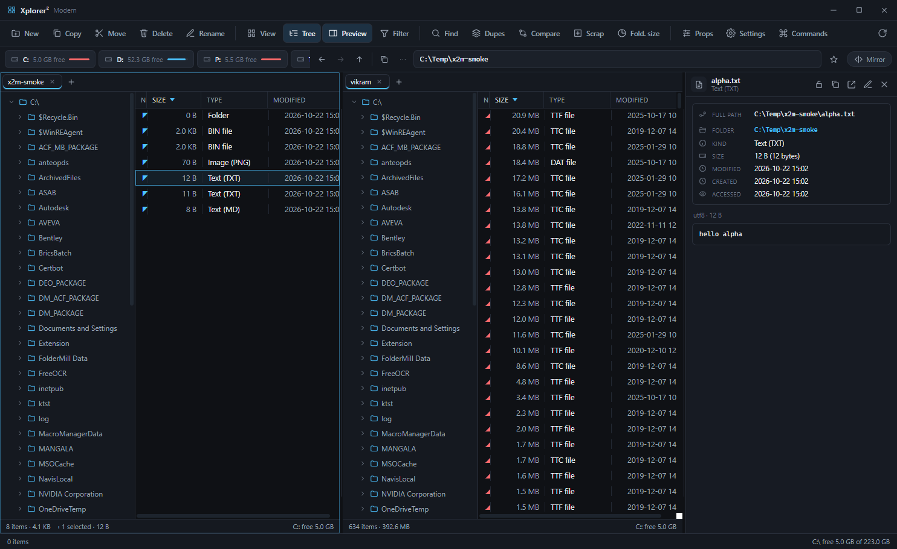

# Xplorer² Modern

A fast, keyboard-first **dual-pane file manager** built with Electron. It keeps the
muscle memory of classic xplorer² — two panes, tabs, a folder tree, scrap panes,
wildcard filters and real file operations — inside a modern, consistent UI.



- **Dual panes + tabs** &nbsp;·&nbsp; independent history per tab, mirror browsing, stack/vertical layout
- **Browser-style navigation** &nbsp;·&nbsp; back / forward / up with dropdown history and a recent-locations menu
- **Preview pane** &nbsp;·&nbsp; images, video, audio, PDF, text and hex, with a metadata card that always shows the full path
- **Scrap panes** &nbsp;·&nbsp; collect files from anywhere (Ctrl+S), mini-scrap docked in each pane
- **Search & duplicates** &nbsp;·&nbsp; wildcard or regex names, content search, size/date filters, duplicate grouping
- **Compare & sync** &nbsp;·&nbsp; colour-coded differences between panes
- **Tools** &nbsp;·&nbsp; mass rename with live preview, folder size/pie, split & merge, ZIP creation, checksums, links, timestamps & attributes, colour tags
- **Path copy** &nbsp;·&nbsp; 14 formats (Windows, Unix, quoted, CMD/PowerShell/C#, file URL, relative…)
- **One icon language** &nbsp;·&nbsp; every glyph is inline SVG from `src/js/icons.js` — no emoji, no mixed metrics
- **Command palette** (Ctrl+K) and context menus built from the same structured menu model

## Download

Grab the latest installer from [Releases](https://github.com/vikramdex-ops/Xplorer2/releases):

| Platform | Artifact |
| --- | --- |
| Windows 10/11 (x64) | `Xplorer2 Modern-<version>-win-x64.exe` (NSIS, per-user, choose install dir) |
| Windows portable | `Xplorer2 Modern-<version>-win-x64.zip` |
| macOS 11+ (Intel & Apple silicon) | `.dmg` / `.zip` |
| Linux (x64) | `.AppImage` / `.deb` |

Builds are produced by GitHub Actions on every `v*` tag.

## Develop

```bash
npm ci
npm start            # run the app
npm run start:debug  # run with --remote-debugging-port=9222
npm run check        # syntax + icon + emoji + asset guards
npm run smoke        # drive the real app through CDP and write screenshots/
```

Requirements: Node 20+ and the platform toolchain electron-builder needs
(NSIS on Windows, Xcode CLT on macOS, `fakeroot`/`dpkg` on Linux for `.deb`).

## Build installers

```bash
npm run icons        # regenerate assets/icon.png, build/icon.png, build/icon.ico
npm run dist         # current platform
npm run dist:win     # NSIS + portable zip
npm run dist:mac     # dmg + zip (x64 + arm64)
npm run dist:linux   # AppImage + deb
```

Output lands in `release/`. See [docs/SHIPPING.md](docs/SHIPPING.md) for the full
release checklist and signing notes.

## Keyboard

| Keys | Action |
| --- | --- |
| `Tab` / `Shift+Tab` | switch pane / focus address bar |
| `Alt+←` / `Alt+→` / `Backspace` | back / forward / up |
| `Ctrl+T` / `Ctrl+F4` | new tab / close tab |
| `Enter` / `F2` / `Del` / `Shift+Del` | open / rename / recycle / delete permanently |
| `F3` | filter current folder |
| `Ctrl+F` / `Ctrl+D` / `F9` | find files / duplicates / compare panes |
| `Ctrl+S` | send selection to scrap |
| `Ctrl+P` | copy path (selection, else current folder) |
| `Ctrl+Q` | bookmark current folder |
| `Ctrl+K` | command palette |
| `Ctrl+,` / `Ctrl+?` | settings / shortcut sheet |
| `F5` / `Ctrl+F5` | copy dialog / copy to other pane |
| `Ctrl+Alt+Z` | toggle preview pane |
| `Ctrl+G` / `Ctrl+R` | folder sizes / mass rename |

## Architecture

```
electron/main.js      main process: filesystem, search, archives, ZIP writer, protocol, IPC
electron/preload.js   contextBridge API (window.x2) — no nodeIntegration in the renderer
src/index.html        application shell
src/css/style.css     design system: tokens + .chr-* primitives + .mi menu rows
src/js/app.js         app shell: panes, commands, palette, context menus, keyboard
src/js/pane.js        pane + tabs + per-tab history, recent locations
src/js/views.js       virtualised list/thumbnails/details view
src/js/panels.js      preview pane (metadata card) and scrap panes
src/js/popup.js       one structured popup model shared by menus and palette
src/js/icons.js       inline SVG icon set + declarative hydration
src/js/filetypes.js   single file-type taxonomy (icons, Type column, previews)
src/js/pathcopy.js    path-copy mode catalog
src/js/tools.js       dialogs and tool implementations
tools/check.mjs       static guards used by CI
tools/smoke.mjs       end-to-end CDP smoke suite + screenshots
tools/make-icon.mjs   dependency-free icon generator
```

Design rules:

1. **One primitive per control** — `.chr-btn`, `.chr-toggle`, `.chr-input`, `.chr-check`, `.mi`.
2. **One icon set** — `icon('name')`; markup uses `<span data-icon="name">` and `hydrateIcons()`.
3. **One popup model** — `{ title, groups: [{ label, items: [{ label, icon, key, hint, run, checked, disabled }] }] }`.
4. **No dead API calls** — every `window.x2.*` used by the renderer has a main-process handler.

## Settings & portable mode

Settings live in the Electron user-data folder (`settings.json`). Drop an empty
`x2m-portable.flag` next to the executable to keep `x2modern.json` beside the app
instead (handy for USB sticks).

## License

MIT © 2026 Asha. Clean-room implementation; not affiliated with the original
xplorer² product.
