<div align="center">


# Hopper

**The internal file manager of Dexterity Design Services Private Limited.**
Dual panes, a real transfer queue, one-key zips, viewers, lot and project-folder tools —
file sharing to colleagues over the office LAN with an `@mention`, and download links for clients.

<sub>Internal software · © 2026 Dexterity Design Services Private Limited · all rights reserved</sub>

[**Website**](https://vikramdex-ops.github.io/Hopper/) ·
[**Download**](https://github.com/vikramdex-ops/Hopper/releases/latest) ·
[What's new](#whats-new-in-25) ·
[Office setup](docs/OFFICE-SETUP.md) ·
[Keyboard](#keyboard)

</div>

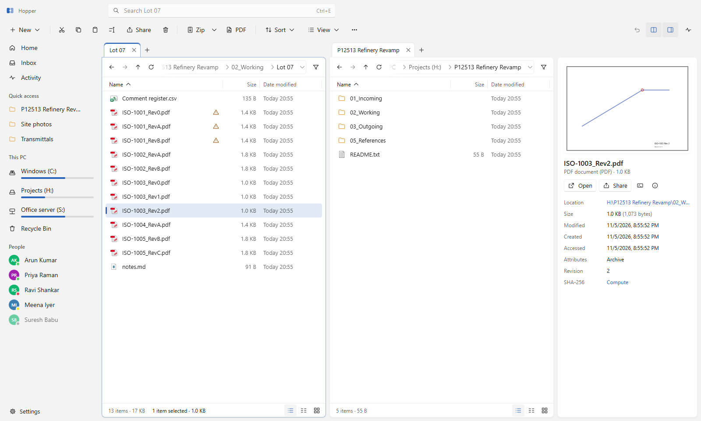

Hopper is built for how Dexterity works — drawing lots in shared folders: send a lot to three
colleagues without writing three messages, send it to the client with one link, zip 2 GB before
the coffee is ready, and never wonder whether a copy over the network really finished.

## Highlights

| | |
| :-- | :-- |
| **Share with `@`** — type `@` and a name, pick people or a group, add a note. Online colleagues receive directly PC-to-PC (encrypted, resumable, checksum-verified); offline ones get it through the office server. Click a person to message them, send files, a folder link or a request. | **Client links (Dexterity Share)** — select files and choose *Create client link* (`Ctrl+Alt+L`). Files stay on the office server; the client gets a link to a branded download page that works on phones too. Expiry of 1–90 days, optional password and download limit, ready-made e-mail text, and *My client links* to see downloads, extend or revoke. Away from Hopper, upload a .zip, .rar or .7z on the browser page and get a link there. |
| **Viewers** — PDF (continuous scroll, `Ctrl`+wheel zoom), Excel, Word, the preview saved in DWG files, MicroStation V7 drawings (`.dgn`, `.i01`…) with zoom, pan and levels, and SmartSketch `.sha` details. No design software needed. | **Project folders** — the *Dexterity project* template asks for job number, name, type, 3D platform, disciplines, sub-projects, areas and review gates, shows the exact tree first and never overwrites. A second template makes a dated issue pack. |
| **Zip in one key** — `Ctrl+Alt+Z` zips the selection with your default preset using every CPU core (bundled 7-Zip). Presets for store-speed, smallest 7z, email-sized parts, password and RAR. Open any archive like a folder; smart-extract never nests folders twice. | **Copies you can watch** — copy, move, delete, zip and extract show a progress window (percentage, current file, speed, time left, Pause / Cancel / Hide) that also asks about name conflicts, with *apply to all*. Everything runs in one background queue; the Transfers panel (`Ctrl+J`) keeps the history. Same-drive moves are instant; flaky shares are retried. |
| **Office tools** — package a lot: check names against your convention, write a transmittal (Excel + PDF), zip and share in one go. PDF merge, split, extract, rotate and reorder. Revisions (`RevA / RevB / Rev0`) group under the latest; unknown orders are flagged, never guessed. | **Hopper's own, top to bottom** — its own context menu, Properties, Open with and folder picker; nothing is handed to Windows Explorer. Path Copy (UNC, Internet, Samba forms), Recycle Bin restore, `Ctrl+Z` undo, the Windows clipboard both ways and drag-out to Outlook or Cliq. |
| **Find it instantly** — a background index of your drives answers as you type; content search on demand; duplicates by content. **Network**: computers and NAS shares on the office network and your saved places, with Hopper's own sign-in. | **Fluent and fast** — Windows 11 look (Mica, light and dark), one pane or two (switch at the top right, `F10`), a *New* menu with your installed document types, a Home start page, drives with "free of total", a sidebar that collapses to a rail (`Ctrl+Shift+B`), announcements, workspaces and lists that stay smooth at 100,000 items. |

<table>
<tr>
<td width="50%">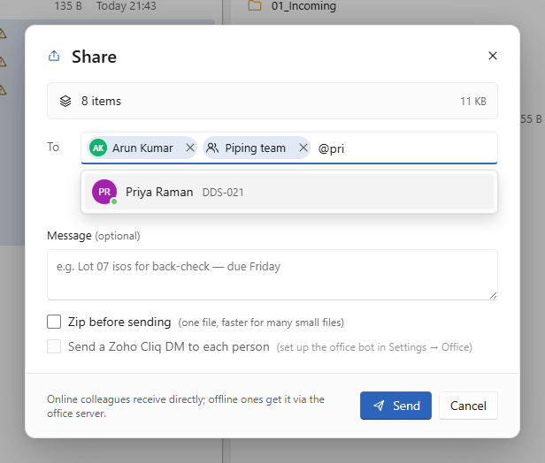<br><sub><b>Share with <code>@</code>.</b> People and groups, a note, optional zip and a Cliq DM.</sub></td>
<td width="50%">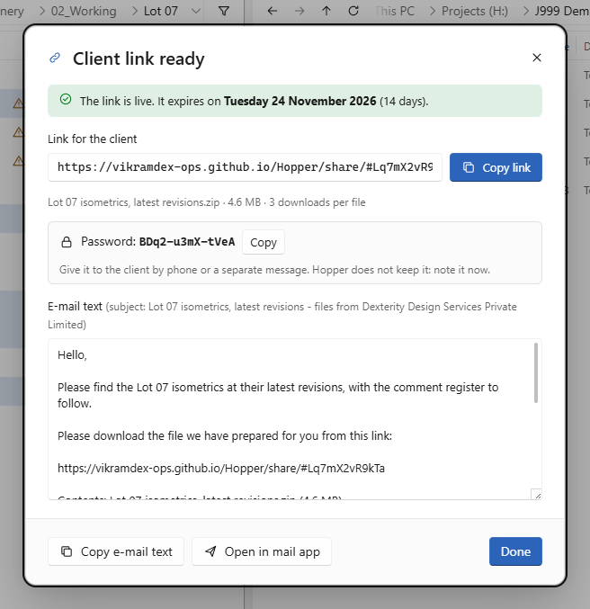<br><sub><b>Client link.</b> The link, the password and the e-mail text with the expiry date.</sub></td>
</tr>
<tr>
<td width="50%">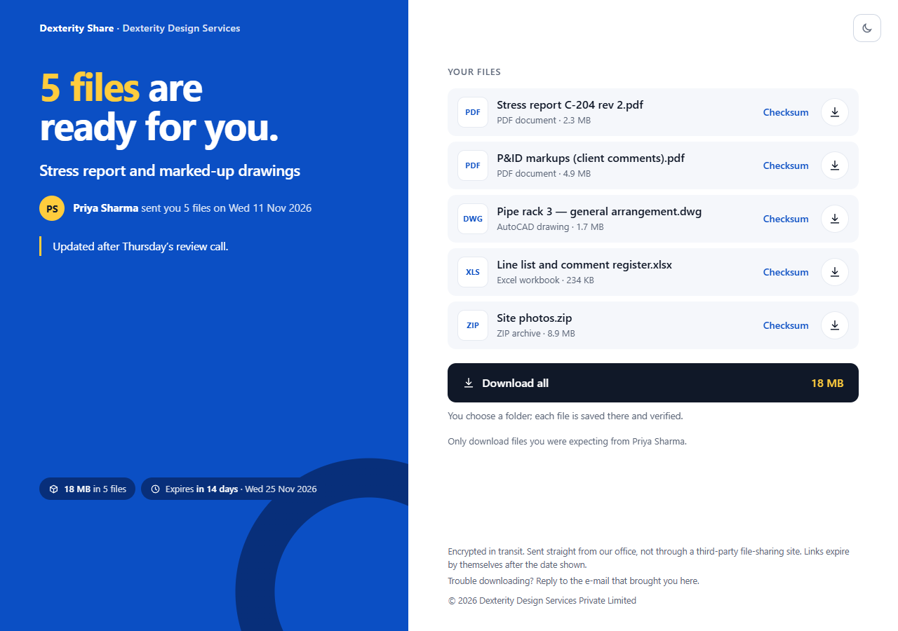<br><sub><b>What the client sees.</b> Who sent it, the note, the expiry, the files and one <i>Download all</i>.</sub></td>
<td width="50%">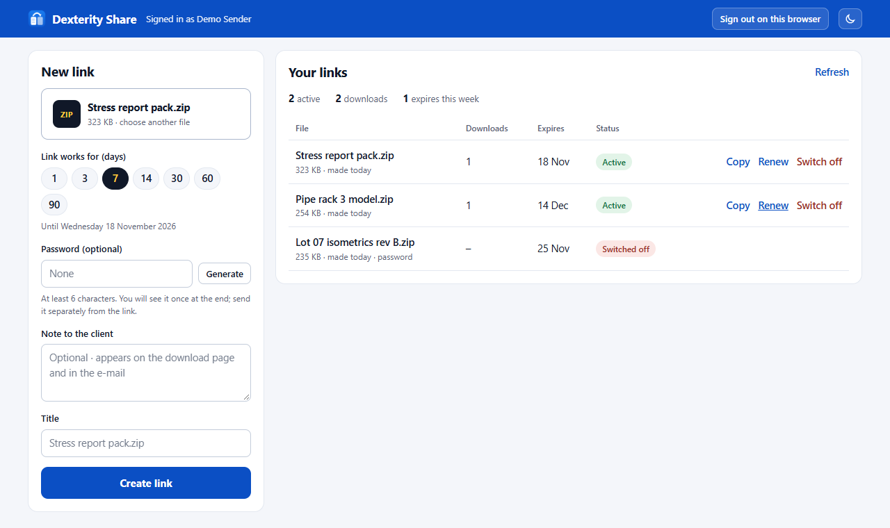<br><sub><b>Links from a browser.</b> Upload a .zip, .rar or .7z; Copy, Renew or Switch off.</sub></td>
</tr>
<tr>
<td>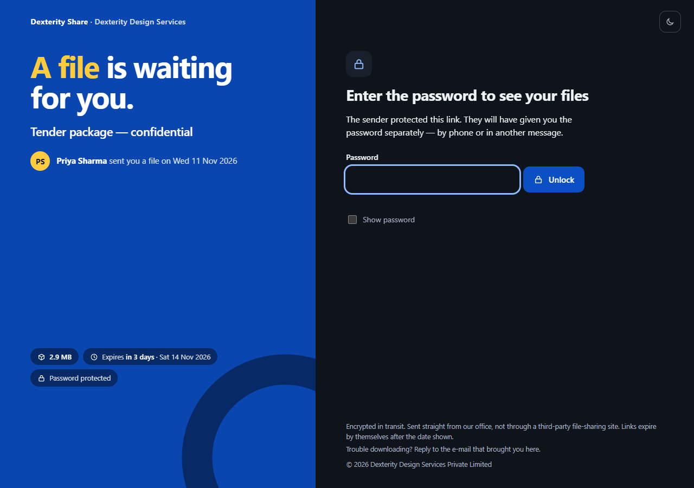<br><sub><b>Password and dark theme.</b> The client page asks for the password first.</sub></td>
<td>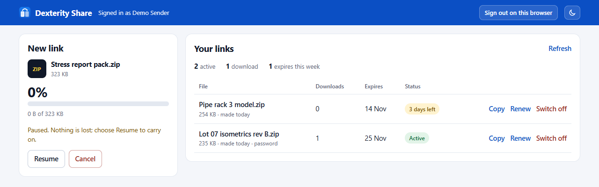<br><sub><b>Uploads in pieces.</b> Pause, Resume or Cancel; a dropped connection is retried.</sub></td>
</tr>
<tr>
<td>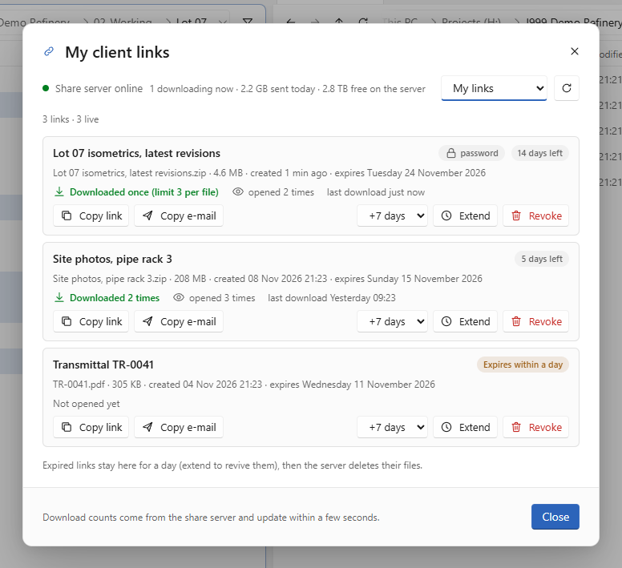<br><sub><b>My client links.</b> Opened, downloaded, days left; extend or revoke.</sub></td>
<td>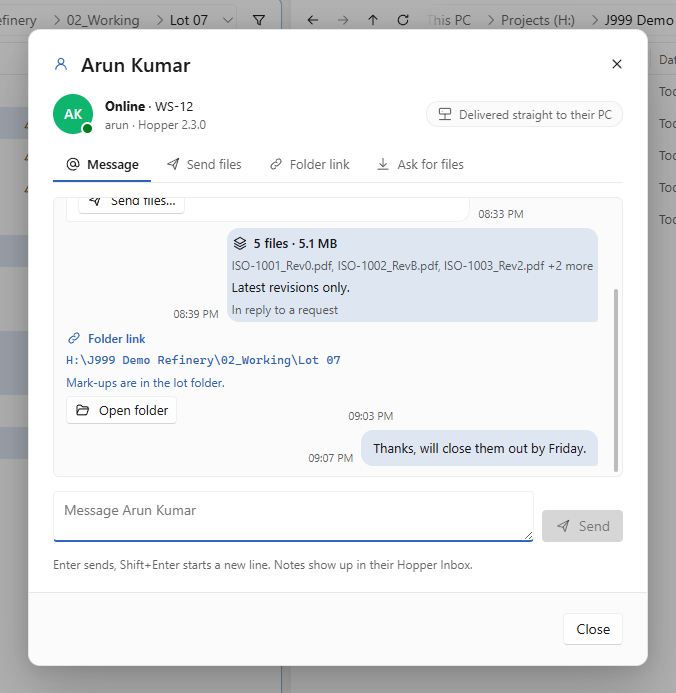<br><sub><b>Person panel.</b> Messages, files, folder links and requests with one colleague.</sub></td>
</tr>
<tr>
<td colspan="2">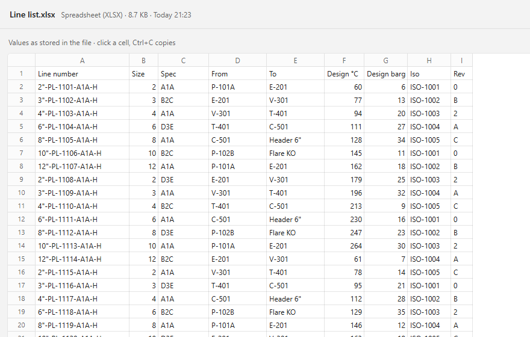<br><sub><b>Viewers.</b> A workbook in the full-window viewer; PDF, Word, DWG previews and MicroStation drawings open the same way.</sub></td>
</tr>
<tr>
<td colspan="2">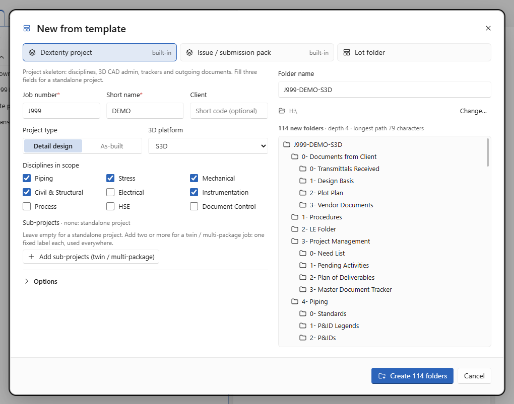<br><sub><b>Project folders.</b> Fill in the job, see the exact tree, create it.</sub></td>
</tr>
<tr>
<td>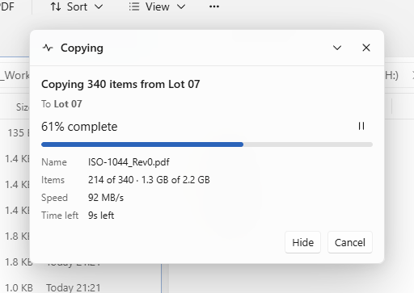<br><sub><b>Progress window.</b> Speed, time left, Pause, Cancel, Hide; conflicts asked in place.</sub></td>
<td>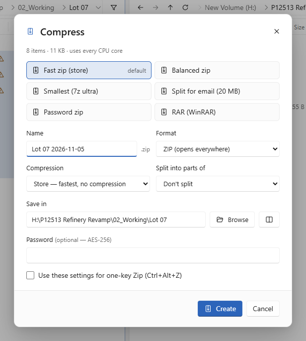<br><sub><b>Presets.</b> One key for the zip you make every day.</sub></td>
</tr>
<tr>
<td>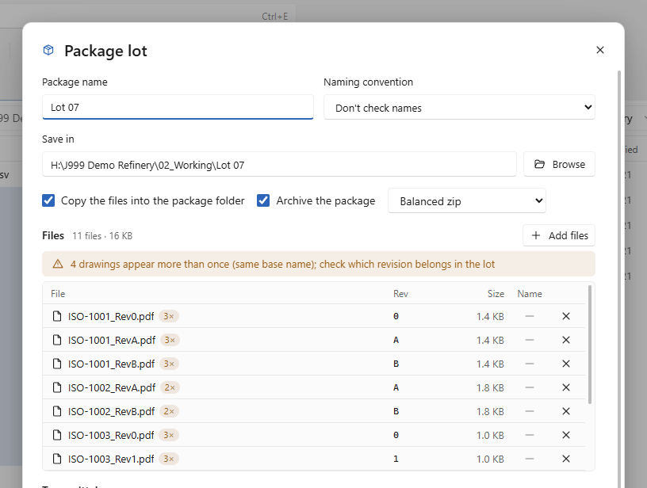<br><sub><b>Lot packager.</b> Convention check, revisions, transmittal, zip.</sub></td>
<td>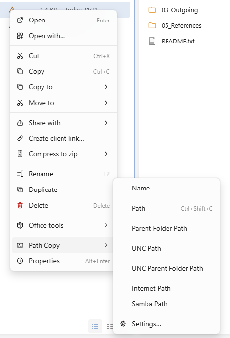<br><sub><b>Path Copy.</b> Hopper's own menu, with every path form.</sub></td>
</tr>
<tr>
<td>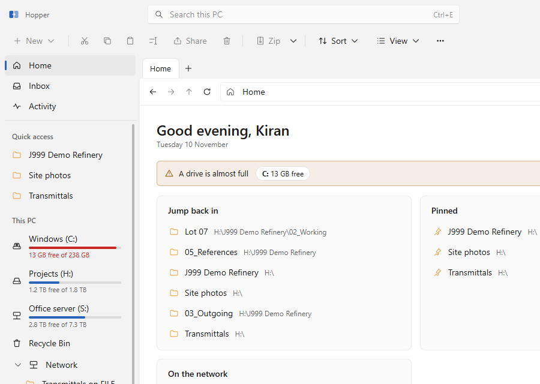<br><sub><b>Home.</b> Recent folders, pinned, Inbox, people and low-disk warnings.</sub></td>
<td>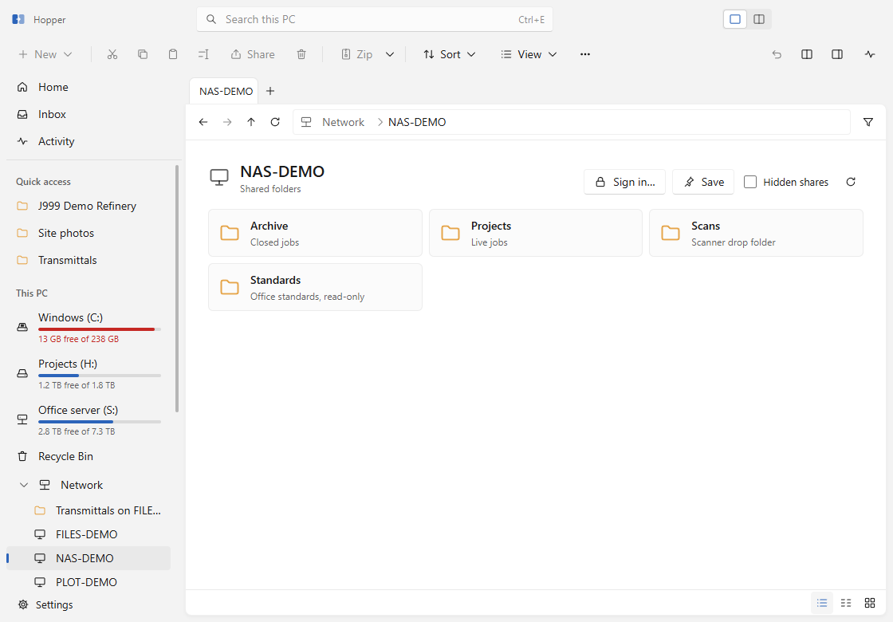<br><sub><b>Network.</b> A server's shared folders and the sidebar's Network node.</sub></td>
</tr>
<tr>
<td>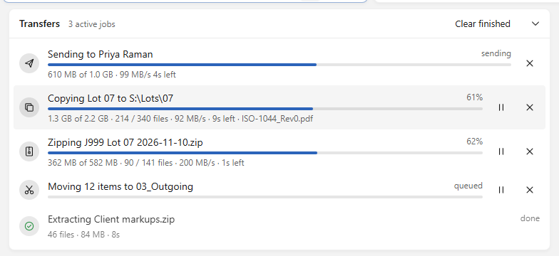<br><sub><b>Transfers panel</b> (<code>Ctrl+J</code>). The whole queue and its history.</sub></td>
<td>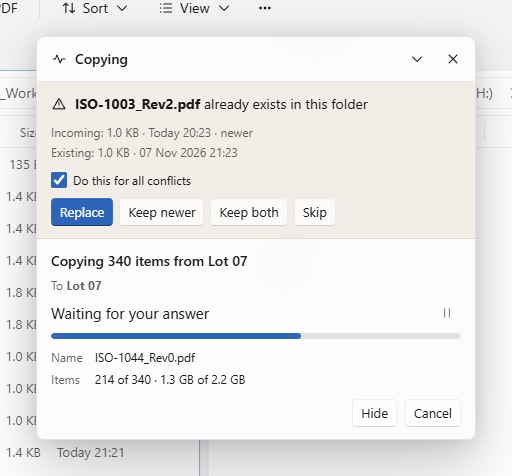<br><sub><b>Conflicts in place.</b> Replace, keep newer, keep both or skip, for all at once.</sub></td>
</tr>
</table>

## What's new in 2.5

- **Anyone can set the office up, once.** Until a PC sets the office up, every PC gets the full
  *Settings → Office* page, so the always-on Dexterity Share server can be any PC. **Use this PC**
  (or **Finish setup on this PC**) locks it: the other PCs' Office pages turn read-only within
  about 20 seconds. That PC and asha, admin2 and admin3 can still change it.
- **Revoke setup** to move the always-on server: every PC gets the full page back until the next
  setup. Client links keep working until the new PC takes over.
- **Announcements for everyone**: any colleague can post one.

## What's new in 2.4.1

A fix release.

- **Typing in dialogs works every time.** Clicking into a text box in Settings, *New
  announcement* or a person's panel (*Message*, *Ask for files*) sometimes left the cursor
  outside the box, so typing went nowhere. Fixed in every dialog.
- **Hopper's own icon and name** on the taskbar, the pinned button, the tray and Windows
  notifications. Before, these could show a blank icon and "Electron".
- **Settings shows what is already done.** *Allow Hopper through Windows Firewall* reads
  **Allowed** in green once the rule is in place, or **Not allowed** with the *Allow* button.
  Allowing again replaces Hopper's rule instead of adding a copy. *Default file manager* shows
  **In use** when Hopper is the default.
- **Folder templates** in Settings → Office are laid out compactly instead of spread over a
  tall, empty area.

## What's new in 2.4

- **Create client links from a browser.** Upload an existing .zip, .rar or .7z on the Dexterity
  Share staff page, choose 1–90 days, an optional password and a note, and get the link and the
  e-mail text, from any PC without Hopper. *Your links* shows each link's downloads and expiry,
  with Copy, Renew and Switch off. Uploads can be paused and resumed and survive a dropped
  connection; up to 5 GB by default.
- **Signing in** needs no password: in Hopper, *My client links → Use in a browser → Make a
  sign-in link*, open it once in the browser and bookmark the page. Switch a browser off there at
  any time. The admin can turn the page off, set the size limit and see everyone's browsers in
  Settings → Office → Dexterity Share ([staff guide](docs/DEXTERITY-SHARE.md),
  [IT guide](docs/DEXTERITY-SHARE-IT.md)).
- **New client download page**: a blue panel that says how many files are ready, who sent them,
  their note and when the link expires, next to the files and one *Download all* button. Every
  state, the dark theme and phones are restyled; it works and is secured as before.

## What's new in 2.3

- **Progress window** for copy, move, delete, zip and extract: percentage, items, current file,
  speed and time left, with Pause, Cancel and Hide; a name conflict is asked in the same window.
  The Transfers panel stays closed unless you open it (`Ctrl+J`); Settings → Files can switch
  back to the panel.
- **One pane / two panes** switch at the top right of the window (also `F10`), remembered.
- **Network** in the sidebar: computers and NAS shares on the office network and your saved
  network places. Opening a computer lists its shared folders; *Add a network place* takes a
  `\\server` or `\\server\share` address; Hopper asks for a user name and password itself when
  a server needs them.
- **New** menu lists the document types your installed programs offer (Word, Excel, PowerPoint
  and others) and creates them from each program's own blank template.
- Fixes: searching again from a results page stays in the folder you were in (and a search from
  Home covers every local disk); one click selects a folder in Hopper's Open dialog; folders on
  shares without change notices refresh by themselves.
- The Zoho Cliq endpoint defaults to the office's Hopper Bot, so the admin only pastes its token
  once ([docs/CLIQ-SETUP.md](docs/CLIQ-SETUP.md)).

## What's new in 2.2

- **Dexterity Share sets itself up.** No separate server software: the office admin chooses
  *Set up Dexterity Share on this PC…* (Settings → Office) and completes three steps — use this
  PC, download the tunnel program, paste a GitHub token with only the *gist* permission — then
  *Test from the internet*. Details: [IT guide](docs/DEXTERITY-SHARE-IT.md).
- Client links are self-contained. A **bandwidth limit** (with a separate office-hours limit)
  is shared equally between downloads, a **disk guard** refuses links that would leave the store
  below its reserve (5 GB by default), and a **download notice** tells you when a client
  downloads. A finished archive or PDF already on the store's drive is linked instantly.
- **Project folder generator**: the *Dexterity project* template with a live tree preview, plus
  a dated issue / submission pack. Templates are editable in Settings.
- **Sidebar**: every drive shows "free of total", and the sidebar collapses to a rail
  (button, View menu or `Ctrl+Shift+B`).

## What's new in 2.1

- **Dexterity Share** — client download links served from the office server, with expiry,
  password, download limit and a branded page ([staff guide](docs/DEXTERITY-SHARE.md)).
- **Person panel, folder links and announcements** over the office network.
- **Path Copy** menu (UNC, Internet and Samba forms) and Hopper's own Properties, Open with and
  folder picker — nothing is handed to Windows Explorer.
- **Viewers** for PDF (Ctrl+wheel zoom), Excel, Word, DWG saved previews and MicroStation V7
  drawings, with no design software installed.
- The PC that sets the office up creates the office key; other PCs join.

## What's new in 2.0

Hopper 2.0 is a ground-up rebuild of the earlier internal *Xplorer² Modern* 1.x, renamed
because xplorer² is another company's product.

- New architecture: the window never waits on the disk. File work runs in a separate engine
  process, sharing in a LAN process, and a small native Windows helper does fast listings,
  the Explorer clipboard, the shell menu and Recycle Bin restore.
- LAN sharing with `@mentions`, direct transfer with server fallback, an Inbox, presence and
  Zoho Cliq notifications.
- Bundled 7-Zip: multithreaded zip/7z, RAR via WinRAR, presets, archives as folders, smart
  extract.
- Transfer queue, quick destinations, undo history, Explorer clipboard and drag-out.
- Lot / transmittal packager, PDF toolkit, revision grouping, folder templates.
- Instant search index, workspaces, live folders, Activity view.
- Every v1 bug found in review is fixed (folder copy, recycle delete, file context menu,
  drag and drop, settings that reset, the 2 MB editor truncation, and more).

See [CHANGELOG.md](CHANGELOG.md) for the full list.

## Download

Dexterity staff: get the latest **`Hopper-<version>-win-x64.exe`** from
[Releases](https://github.com/vikramdex-ops/Hopper/releases/latest) (Windows 10 and 11, x64)
or the [Hopper website](https://vikramdex-ops.github.io/Hopper/). A portable `.zip` is
published alongside it.

The installer is per-user (no admin needed) and updates itself silently in the background.
Builds are not code-signed yet, so SmartScreen may ask you to confirm the first time;
`SHA256SUMS.txt` on every release lets you verify the download.

## Setting it up for an office

A one-time setup, about five minutes:

1. Install Hopper on each PC.
2. **Whoever sets the office up** (any PC, until one finishes): **Settings → Office**, point
   *Office config file* at a shared folder every PC can reach, create the office key and
   **Save to server**. **Use this PC** in Dexterity Share setup, or **Finish setup on this PC**,
   locks the Office page to that PC (plus asha, admin2 and admin3); **Revoke setup** opens it again.
3. **Everyone else joins**: automatically from the shared config, from an invite the admin sends
   over the network (**Invite PCs**), or by pasting the key. Then **Settings → Sharing → Allow
   through Windows Firewall** (asks for admin once; the row then reads **Allowed**) and fill in
   your name and Zoho email.
4. Optional: Cliq DMs (the endpoint already points at the office's Hopper Bot; the admin pastes
   its webhook token once — [docs/CLIQ-SETUP.md](docs/CLIQ-SETUP.md)), groups, folder templates,
   naming conventions and revision rules.
5. Optional, for client links: on one office PC that stays on, run **Set up Dexterity
   Share on this PC…** (Settings → Office → Dexterity Share). See
   [docs/DEXTERITY-SHARE-IT.md](docs/DEXTERITY-SHARE-IT.md); how staff use it is in
   [docs/DEXTERITY-SHARE.md](docs/DEXTERITY-SHARE.md).

Details: [docs/OFFICE-SETUP.md](docs/OFFICE-SETUP.md).

## Keyboard

| Keys | Action |
| :-- | :-- |
| `Ctrl+K` | command palette (every action, with its shortcut) |
| `Ctrl+G` | go to any folder by name |
| `Ctrl+E` | search |
| `Tab` | switch pane · `F10` one pane / two panes |
| `Alt+←` `Alt+→` `Alt+↑` / `Backspace` | back, forward, up |
| `Ctrl+T` `Ctrl+W` `Ctrl+Shift+T` | new, close, reopen tab |
| `Ctrl+C` `Ctrl+X` `Ctrl+V` | copy, cut, paste — through the Windows clipboard |
| `Ctrl+F5` / `Ctrl+F6` | copy / move to the other pane |
| `Ctrl+Alt+C` / `Ctrl+Alt+M` | copy to… / move to… (recent and pinned destinations) |
| `Ctrl+Alt+Z` / `Ctrl+Shift+Z` | zip here with default preset / with options |
| `Ctrl+Alt+X` | extract here (smart) |
| `Ctrl+Shift+Enter` | share with people |
| `Ctrl+Alt+L` | create a client link (Dexterity Share) |
| `Ctrl+Shift+C` | copy path (your default Path Copy form) |
| `Alt+Enter` | properties |
| `Ctrl+Shift+B` | show / hide the sidebar |
| `F2` / `Ctrl+Shift+R` | rename / rename many |
| `Del` / `Shift+Del` / `Ctrl+Z` | recycle / delete permanently / undo |
| `Space` | Quick Look |
| `Ctrl+Shift+P` | package a lot / transmittal |
| `Ctrl+J` | Transfers panel (queue and history) |
| `Ctrl+,` / `F1` | settings / all shortcuts |

## Build from source (maintainers)

Requirements: Windows 10/11, Node.js 24, and the .NET Framework 4.8 compiler that ships with
Windows (used for the native helper).

```bash
git clone https://github.com/vikramdex-ops/Hopper.git
cd Hopper
npm ci
npm run build          # native helper + bundles
npx electron .         # run it
npm run dist           # installer and portable zip in release/
```

```bash
npm test               # unit tests (revisions, office tools, LAN protocol)
npm run e2e            # drives the real app end to end
npm run shots          # regenerates the screenshots
```

## Architecture

```
src/main/      window, tray, hopper:// protocol (files, shell thumbnails, icons), IPC, updater
src/preload/   the small, typed window.hopper API (sandboxed, context-isolated)
src/engine/    utility process: listing, transfer queue, undo, 7-Zip, search index, watchers,
               PDF, packager, templates
src/lan/       utility process: discovery, TLS-PSK transfers, server inbox, Cliq bot
src/renderer/  Svelte 5 UI
src/shared/    types, RPC, revision rules
native/        HopperShell.cs: FindFirstFileEx listing, Explorer clipboard, shell context menu,
               properties, drives, Recycle Bin
vendor/7zip/   7-Zip 26.05 (LGPL, see vendor/7zip/License.txt)
```

The renderer talks to the engine and LAN processes over direct MessagePorts; the main process
only handles OS integration. Heavy libraries (PDF, Excel) load the first time they're used.

## Privacy and security

- Files shared with colleagues move only inside your network: directly between office PCs over
  TLS (pre-shared office key), or through the office server folder you configure.
- Client links (Dexterity Share) are the one exception you choose: the files stay on the office
  server and are served from it only to people who have the link, until it expires. Nothing is
  uploaded to a third-party file service.
- The Cliq bot receives only the notification text (who sent what, and the message).
- The UI runs sandboxed with no Node access; remote pages can't open windows in the app.

## Licence

**Proprietary — internal use only.** Hopper is © 2026 Dexterity Design Services Private Limited.
All rights reserved. It is provided for use by the company's staff and authorised contractors;
no licence is granted to anyone else to use, copy, modify or distribute it. See [LICENSE](LICENSE).

Third-party components keep their own licences: 7-Zip is © Igor Pavlov under the GNU LGPL with
the unRAR restriction (`vendor/7zip/License.txt`); Electron and the npm packages in
`package.json` are under their respective open-source licences. Hopper is not affiliated with
zabkat's xplorer², Microsoft, Zoho or RARLAB. Screenshots use demo data and demo colleagues.
