<div align="center">

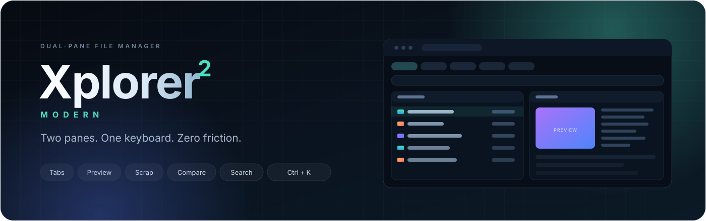

<br>

<a href="https://github.com/vikramdex-ops/Xplorer2/actions/workflows/build.yml"></a>


**Two panes. One keyboard. Zero friction.**

A keyboard-first dual-pane file manager built on Electron — the muscle memory of
classic xplorer², the finish of a modern desktop app.

<a href="#download"><b>Download</b></a> &nbsp;·&nbsp;
<a href="#a-tour-in-eleven-screens"><b>Tour</b></a> &nbsp;·&nbsp;
<a href="#keyboard-map"><b>Keyboard</b></a> &nbsp;·&nbsp;
<a href="#build-from-source"><b>Build</b></a>

</div>

---

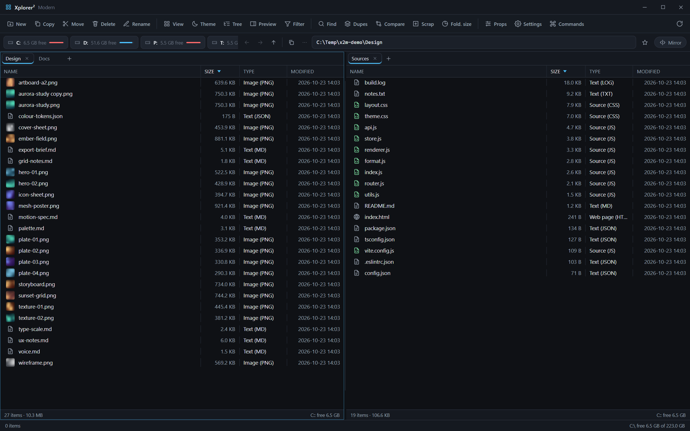

<p align="center"><sub><b>The workspace.</b> Two independent panes, tab strips, a drive bar with live capacity, and one ribbon that never overflows.</sub></p>

Windows Explorer forgets where you were. Finder forgets what you selected. Most
"modern" file managers trade the keyboard for whitespace. Xplorer² Modern keeps
both panes, both histories and both selections — and puts every operation one
keystroke away.

| &nbsp; | &nbsp; |
| :-- | :-- |
| **Dual panes + tabs**<br>Independent history per tab, mirror browsing, stack or vertical split. | **Browser memory**<br>Back, forward and up with dropdown histories plus a recent-locations menu in the address bar. |
| **Preview that reads everything**<br>Markdown, HTML, CSV, JSON, code, fonts, archives, images, video, audio, PDF and hex — plus a Quick Look overlay (`Space`) and an IrfanView-style image viewer (`Ctrl+I`). | **Scrap panes**<br>Collect files from anywhere with `Ctrl+S`; a mini-scrap docks inside each pane. |
| **Search & duplicates**<br>Wildcard or regex names, content search, size and date filters, duplicate grouping. | **Compare & sync**<br>Colour-coded differences between the two panes, per side, per row. |
| **Real tools, not menu stubs**<br>Mass rename with live preview, folder sizes and pie, split & merge, ZIP writing, checksums, links, timestamps, attributes, colour tags. | **One path, fourteen shapes**<br>Copy paths as Windows, Unix, quoted, CMD, PowerShell, C#, file URL, relative and more. |

---

## A tour in eleven screens

### 1. Inspect without opening

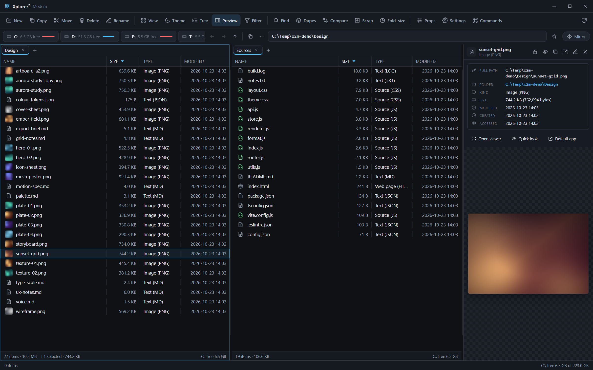

Select a file and the preview pane renders it immediately: **markdown** rendered,
**HTML** sandboxed, **CSV/TSV** as a real table, **JSON/XML/YAML** syntax-coloured,
syntax-highlighted source, **fonts** with a live glyph specimen, **archives** with
their entry list, images, video, audio, PDF and a hex/metadata view for binaries.
The metadata card always shows the **full resource path**, parent folder, kind,
exact byte count and all three timestamps, each row copyable. Media streams through
a dedicated `x2file://` handler, so large files and PDFs open without loading the
whole thing into memory. Press `Space` for a Quick Look overlay of the focused file
— arrow keys walk the folder — or `Ctrl+I` for the full image viewer.

<br>

### 2. Summon any command

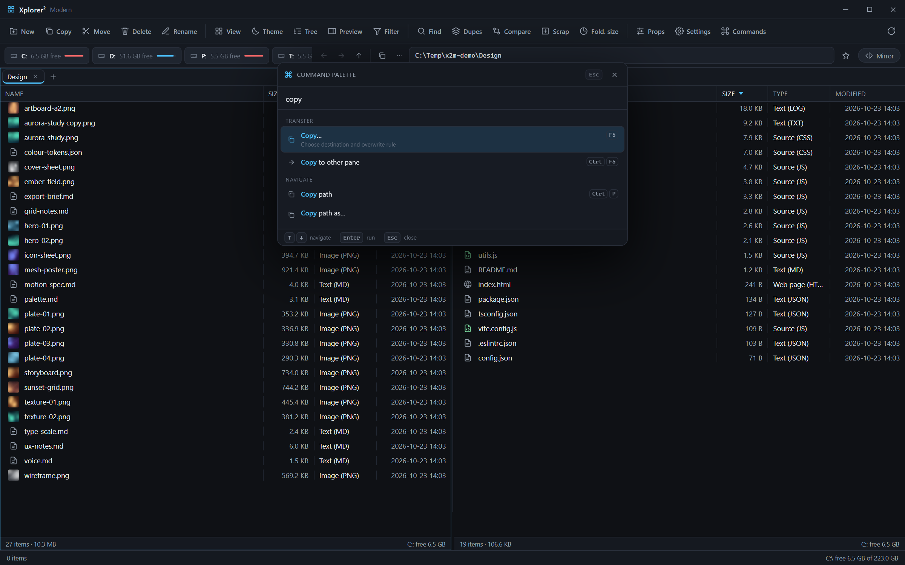

`Ctrl+K` opens a command palette built from the same structured menu model as the
context menus: groups, icons, shortcut chips and descriptions. Type a fragment —
"copy", "rename", "scrap" — and run it without leaving the keyboard.

<br>

### 3. Right-click something useful

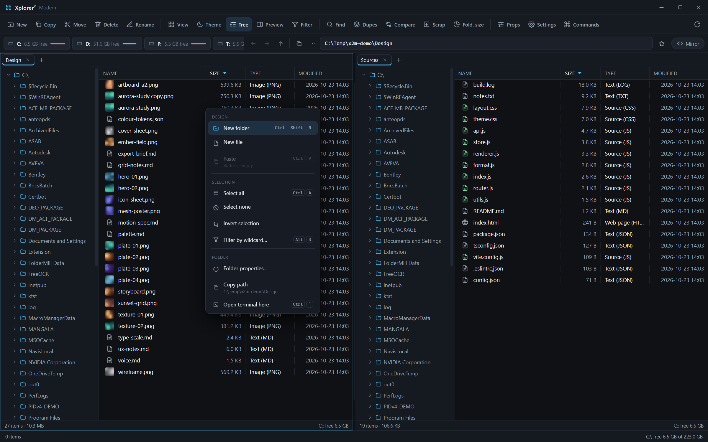

One menu model everywhere. Groups, separators, real keyboard-hint columns, toggled
state and disabled items that explain why they are disabled. Nothing is decorative:
every entry is wired to the same command as its shortcut.

<br>

### 4. Diff two folders in one keystroke

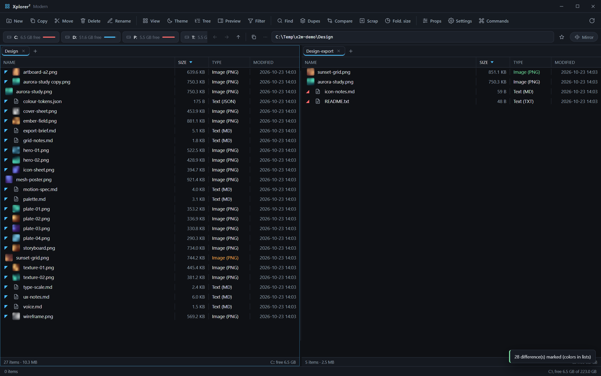

`F9` compares both panes and marks every row: newer on the left, newer on the
right, newer in both, or present on only one side. Identical files stay quiet, so
the list reads as a difference report instead of a wall of colour.

<br>

### 5. Find the copies, not the names

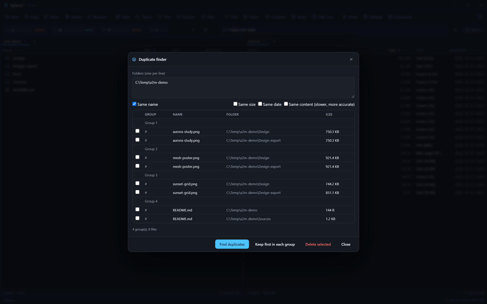

Group by name, size, date or content hash; preview the groups before acting. Keep
the first item in each group in one click, or tick exactly what should go.

<br>

### 6. Collect across the disk

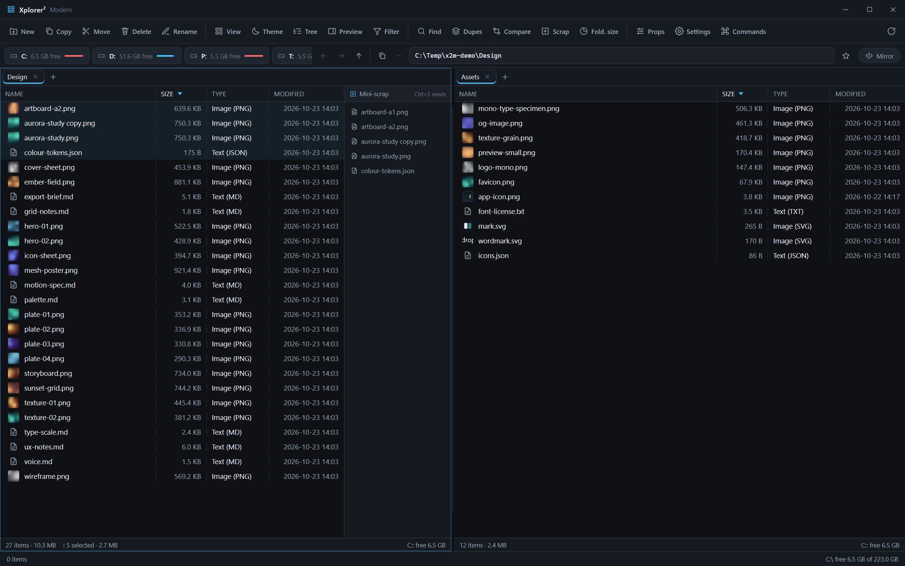

The scrap is a shelf, not a folder. Send selections from any location with
`Ctrl+S`; the mini-scrap stays docked in the pane while you keep browsing. Open
the full scrap pane to reorder, remove or save the shelf as CSV.

<br>

### 7. The same tool in daylight

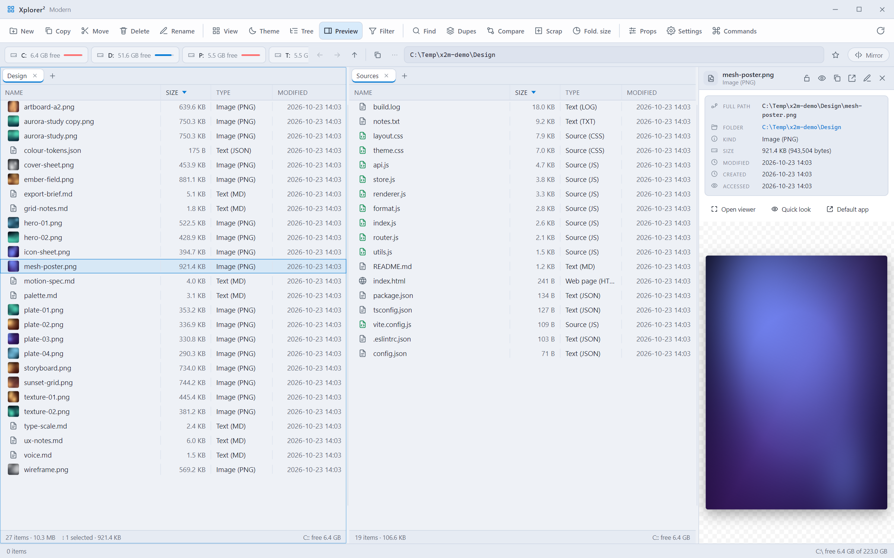

The theme toggle flips every token — chrome, panes, menus, dialogs and the metadata
card — and remembers the choice. No half-converted widgets, no white flash.

<br>

### 8. Operations that show their work

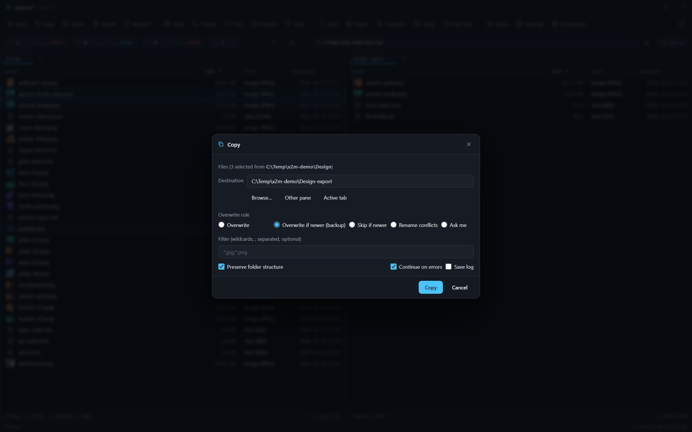

Copy and move ask where, what rule to apply on conflict (overwrite, overwrite if
newer with backup, skip, rename, ask), an optional wildcard filter, folder-structure
preservation, continue-on-error and a save log switch. Progress runs in the status
bar and can be cancelled.

<br>

### 9. Tune it, then forget it

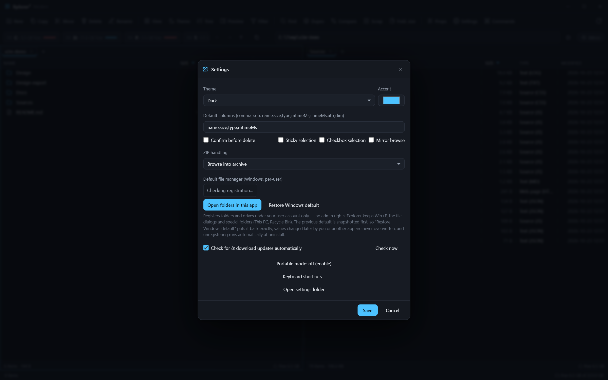

Theme, accent, columns, ZIP handling, confirmation rules, portable mode — plus two
features that make it feel installed rather than downloaded:

- **Default file manager (Windows, per-user).** Registers folders and drives for
  your account only, snapshots your previous default first, and leaves later
  changes made by you or another app untouched. Uninstalling reverts it.
- **Silent auto-update.** Checks and downloads in the background, applies on quit.
  Set it once and versions stop being a chore.

---

### 10. The image viewer

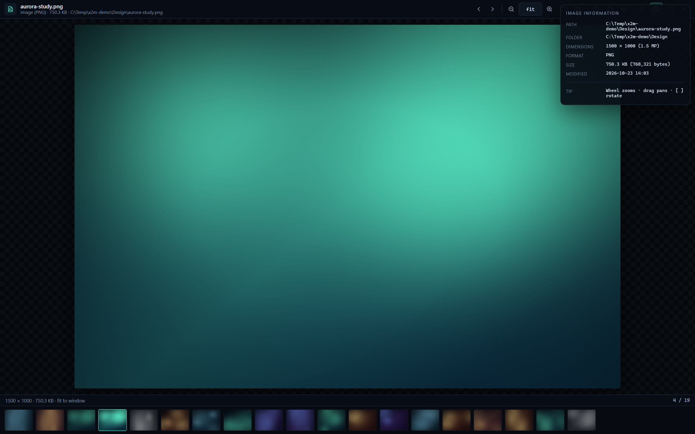

`Ctrl+I` (or *Image viewer* in the context menu) opens the built-in viewer:
wheel zoom at the cursor, fit / actual-size, 10–1600% with a live percentage, drag
to pan, `[` / `]` to rotate, a filmstrip of the folder's other images, slideshow,
fullscreen, and an **Info panel with real EXIF** — camera, lens, exposure, ISO —
read in the main process. Arrow keys walk the folder and the pane selection follows.

---

## What's new in 1.3.0

- **One title bar, not two** — the window is now frameless on Windows/Linux with a
  single custom bar: drag anywhere, double-click to maximise, state-aware
  maximise/restore glyph, Windows-style red close hover. macOS gets the traffic
  lights inset over the same bar.
- **Image viewer** (`Ctrl+I`) — zoom, pan, rotate, filmstrip, slideshow, fullscreen
  and an EXIF info panel.
- **Quick Look** (`Space`) — instant overlay preview with arrow-key navigation and
  quick actions, closing with `Escape`.
- **Rich previews everywhere** — markdown, HTML, CSV/TSV, JSON/XML/YAML, fonts,
  archives, media and hex all render in the pane, Quick Look and the viewer shell.
- **Explorer-grade mouse and keyboard parity** — middle-click a folder to open it
  in a new tab (a file opens with its app), middle-click a tab to close it, drag
  tabs to reorder, `Ctrl+W` closes a tab, `Alt+D` / `Ctrl+L` focus the address bar.

See [CHANGELOG.md](CHANGELOG.md) for the full history (including 1.2.0: default
file manager, theme toggle, silent auto-update).

---

## Download

Grab the latest build from [Releases](https://github.com/vikramdex-ops/Xplorer2/releases):

| Platform | Artifact | Notes |
| :-- | :-- | :-- |
| **Windows 10/11 (x64)** | `Xplorer2-Modern-<version>-win-x64.exe` | NSIS, per-user install, choose the folder, desktop + Start-menu shortcuts |
| **Windows portable** | `Xplorer2-Modern-<version>-win-x64.zip` | Drop `x2m-portable.flag` beside the exe to keep settings on the stick |
| **macOS 11+** | `.dmg` / `.zip` | Intel and Apple silicon |
| **Linux (x64)** | `.AppImage` / `.deb` | AppImage needs `libfuse2` on newer distros |

Builds are produced by GitHub Actions on every `v*` tag, with the updater metadata
(`latest.yml`, blockmap) attached alongside the installers.

> Unsigned builds show a SmartScreen prompt on Windows and a Gatekeeper warning on
> macOS. The checksums in the release notes let you verify the download.

---

## Keyboard map

<details open>
<summary><b>Navigation, files and tools</b></summary>

| Keys | Action |
| :-- | :-- |
| <kbd>Tab</kbd> / <kbd>Shift</kbd>+<kbd>Tab</kbd> | switch pane / focus the address bar |
| <kbd>Alt</kbd>+<kbd>←</kbd> / <kbd>Alt</kbd>+<kbd>→</kbd> / <kbd>Backspace</kbd> | back / forward / up one level |
| <kbd>Ctrl</kbd>+<kbd>T</kbd> / <kbd>Ctrl</kbd>+<kbd>W</kbd> | new tab / close tab (also <kbd>Ctrl</kbd>+<kbd>F4</kbd>; middle-click a tab closes it) |
| <kbd>Alt</kbd>+<kbd>D</kbd> / <kbd>Ctrl</kbd>+<kbd>L</kbd> | focus the address bar |
| <kbd>Space</kbd> | Quick Look the focused file |
| <kbd>Ctrl</kbd>+<kbd>I</kbd> | open the image viewer |
| <kbd>Enter</kbd> / <kbd>F2</kbd> / <kbd>Del</kbd> / <kbd>Shift</kbd>+<kbd>Del</kbd> | open / rename / recycle / delete permanently |
| <kbd>F3</kbd> | filter the current folder (wildcards) |
| <kbd>Ctrl</kbd>+<kbd>F</kbd> / <kbd>Ctrl</kbd>+<kbd>D</kbd> / <kbd>F9</kbd> | find files / duplicates / compare panes |
| <kbd>Ctrl</kbd>+<kbd>S</kbd> | send the selection to the scrap |
| <kbd>Ctrl</kbd>+<kbd>P</kbd> | copy path (selection first, then the folder) |
| <kbd>Ctrl</kbd>+<kbd>Q</kbd> | bookmark the current folder |
| <kbd>Ctrl</kbd>+<kbd>K</kbd> | command palette |
| <kbd>Ctrl</kbd>+<kbd>,</kbd> / <kbd>Ctrl</kbd>+<kbd>?</kbd> | settings / shortcut sheet |
| <kbd>F5</kbd> / <kbd>Ctrl</kbd>+<kbd>F5</kbd> | copy dialog / copy straight to the other pane |
| <kbd>Ctrl</kbd>+<kbd>Alt</kbd>+<kbd>Z</kbd> | toggle the preview pane |
| <kbd>Ctrl</kbd>+<kbd>G</kbd> / <kbd>Ctrl</kbd>+<kbd>R</kbd> | folder sizes / mass rename |

</details>

---

## Build from source

```bash
git clone https://github.com/vikramdex-ops/Xplorer2.git
cd Xplorer2
npm ci
npm start            # run the app
```

Requirements: Node 20+ and whatever electron-builder needs for your platform
(NSIS on Windows, Xcode command-line tools on macOS, `fakeroot`/`dpkg` on Linux for
`.deb`).

```bash
npm run check        # syntax, icon, emoji and asset guards
npm run smoke        # drive the real app over CDP, write screenshots/
npm run shots        # regenerate the README gallery in docs/screenshots/
npm run icons        # regenerate assets/icon.png, build/icon.png, build/icon.ico

npm run dist:win     # NSIS installer + portable zip
npm run dist:mac     # dmg + zip (x64 and arm64)
npm run dist:linux   # AppImage + deb
```

Output lands in `release/`. [docs/SHIPPING.md](docs/SHIPPING.md) has the full release
checklist, signing notes and the post-release smoke list.

Every screenshot in this README is produced by `npm run shots`: it boots the real
application, fills a demo folder with generated artwork, drives genuine UI states
over the Chrome DevTools Protocol and captures them at 1.5× — no mock-ups, no
composites.

---

## Architecture

<details>
<summary><b>Where everything lives</b></summary>

```
electron/main.js      main process: filesystem, search, archives, ZIP writer, x2file://, IPC
electron/preload.js   contextBridge API (window.x2) — no nodeIntegration in the renderer
electron/defmgr.js    per-user default file manager registration and safe revert
src/index.html        application shell
src/css/style.css     design system: tokens → .chr-* primitives → chrome → panels → menus
src/js/app.js         app shell: panes, commands, palette, context menus, keyboard
src/js/pane.js        pane, tabs, per-tab history, recent locations
src/js/views.js       virtualised details / list / thumbnail views
src/js/preview.js     rich preview renderer (md, html, csv, json, fonts, archives, media)
src/js/viewer.js      image viewer overlay + Space-bar Quick Look
src/js/panels.js      preview pane (metadata card) and scrap panes
src/js/popup.js       one structured popup model shared by menus and the palette
src/js/icons.js       inline SVG icon set + declarative hydration
src/js/filetypes.js   single file-type taxonomy (icons, Type column, previews)
src/js/pathcopy.js    path-copy mode catalog
src/js/tools.js       dialogs and tool implementations
tools/check.mjs       static guards used by CI
tools/smoke.mjs       end-to-end CDP smoke suite
tools/make-shots.mjs  README screenshot studio
tools/make-icon.mjs   dependency-free icon generator
```

**Design rules**

1. **One primitive per control** — `.chr-btn`, `.chr-toggle`, `.chr-input`, `.chr-check`, `.mi`.
2. **One icon set** — `icon('name')`; markup uses `<span data-icon="name">` and `hydrateIcons()`.
3. **One popup model** — `{ title, groups: [{ label, items: [{ label, icon, key, hint, run, checked, disabled }] }] }`.
4. **No dead API calls** — every `window.x2.*` used by the renderer has a main-process handler.

</details>

## Settings & portable mode

Settings live in the Electron user-data folder (`settings.json`). Drop an empty
`x2m-portable.flag` next to the executable to keep `x2modern.json` beside the app
instead — handy for a USB stick.

## Licence

MIT © 2026 Asha. Clean-room implementation; not affiliated with the original
xplorer² product. Artwork in the screenshots is generated demo content.
