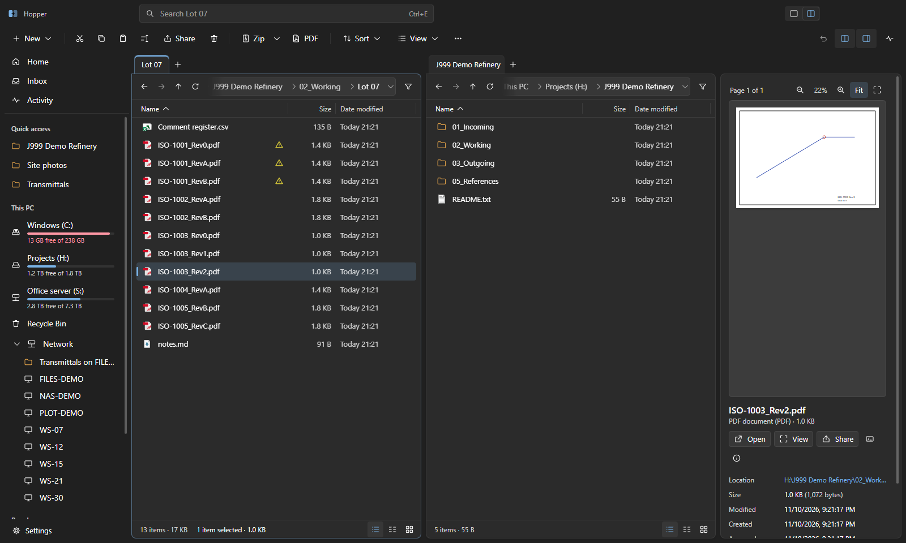
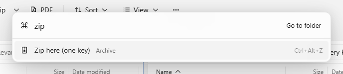

<div align="center">


# Hopper

**The internal file manager of Dexterity Design Services Private Limited.**
Dual panes, a real transfer queue, one-key zips, PDF and lot tools —
and file sharing to colleagues over the office LAN with an `@mention`.

<sub>Internal software · © 2026 Dexterity Design Services Private Limited · all rights reserved</sub>

[**Website**](https://vikramdex-ops.github.io/Hopper/) ·
[**Download**](https://github.com/vikramdex-ops/Hopper/releases/latest) ·
[What's new](#whats-new-in-20) ·
[Office setup](docs/OFFICE-SETUP.md) ·
[Keyboard](#keyboard)

</div>


Hopper is built for how Dexterity works — drawing lots in shared folders: send a lot to three
colleagues without writing three messages, zip 2 GB before the coffee is ready, and never
wonder whether a copy over the network really finished.

## Highlights

| | |
| :-- | :-- |
| **Share with `@`** — type `@` and a name, pick people or a group, add a note. Online colleagues receive directly PC-to-PC (encrypted, resumable, checksum-verified); offline ones get it through the office server. A Zoho Cliq DM tells each person what arrived. | **Zip in one key** — `Ctrl+Alt+Z` zips the selection with your default preset using every CPU core (bundled 7-Zip). Presets for store-speed, smallest 7z, email-sized parts, password and RAR. Open any archive like a folder; smart-extract never nests folders twice. |
| **A real transfer queue** — every copy, move, zip and share runs in the background with speed, ETA, pause/resume and one conflict prompt with *apply to all*. Moves on the same drive are instant. Optional checksum verify. Survives flaky network shares. | **Explorer-grade** — the real Windows clipboard (copy here, paste in Explorer and back), drag files out to Explorer, Outlook or Cliq, the full Windows context menu one click away, Properties, Recycle Bin restore and `Ctrl+Z` undo for copy, move, rename, new and delete. |
| **Office tools** — package a lot: check names against your convention, write a transmittal (Excel + PDF), zip and share in one go. PDF merge, split, extract, rotate and reorder. Folder templates for projects and lots. | **Revision-aware** — `ISO-1001_RevA / RevB / Rev0` group under the latest; out-of-sequence or unknown orders are flagged for a manual check, never guessed. Rules live in the shared office config. |
| **Find it instantly** — a background index of your drives answers as you type; content search on demand; duplicates by content. | **Fluent and fast** — Windows 11 look (Mica, light and dark), real Windows file icons and thumbnails, virtualised lists that stay smooth at 100,000 items, workspaces and live-updating folders. |

<table>
<tr>
<td width="50%"><br><sub><b>Share with <code>@</code>.</b> People and groups, a note, optional zip and a Cliq DM.</sub></td>
<td width="50%"><br><sub><b>The transfer queue.</b> Speed, ETA, pause and resume for everything.</sub></td>
</tr>
<tr>
<td><br><sub><b>Lot packager.</b> Convention check, revisions, transmittal, zip.</sub></td>
<td><br><sub><b>Presets.</b> One key for the zip you make every day.</sub></td>
</tr>
<tr>
<td><br><sub><b>Dark theme</b> that follows Windows.</sub></td>
<td><br><sub><b>Command palette</b> (<code>Ctrl+K</code>) for every action.</sub></td>
</tr>
</table>

## What's new in 2.1

- **Dexterity Share** — client download links served from the office server, with expiry,
  password and a branded page ([staff guide](docs/DEXTERITY-SHARE.md), [IT guide](docs/DEXTERITY-SHARE-IT.md)).
- **Person panel, folder links and announcements** over the office network.
- **Path Copy** menu (UNC, Internet and Samba forms) and Hopper's own Properties, Open with and
  folder picker — nothing is handed to Windows Explorer.
- **Viewers** for PDF (Ctrl+wheel zoom), Excel, Word, DWG saved previews and MicroStation V7
  drawings, with no design software installed.
- Only the office admin can create the office key; other PCs join.

## What's new in 2.0

Hopper 2.0 is a ground-up rebuild of the earlier internal *Xplorer² Modern* 1.x, renamed
because xplorer² is another company's product.

- New architecture: the window never waits on the disk. File work runs in a separate engine
  process, sharing in a LAN process, and a small native Windows helper does fast listings,
  the Explorer clipboard, the shell menu and Recycle Bin restore.
- LAN sharing with `@mentions`, direct transfer with server fallback, an Inbox, presence and
  Zoho Cliq notifications.
- Bundled 7-Zip: multithreaded zip/7z, RAR via WinRAR, presets, archives as folders, smart
  extract.
- Transfer queue, quick destinations, undo history, Explorer clipboard and drag-out.
- Lot / transmittal packager, PDF toolkit, revision grouping, folder templates.
- Instant search index, workspaces, live folders, Activity view.
- Every v1 bug found in review is fixed (folder copy, recycle delete, file context menu,
  drag and drop, settings that reset, the 2 MB editor truncation, and more).

See [CHANGELOG.md](CHANGELOG.md) for the full list.

## Download

Dexterity staff: get the latest **`Hopper-<version>-win-x64.exe`** from
[Releases](https://github.com/vikramdex-ops/Hopper/releases/latest) (Windows 10 and 11, x64)
or the [Hopper website](https://vikramdex-ops.github.io/Hopper/). A portable `.zip` is
published alongside it.

The installer is per-user (no admin needed) and updates itself silently in the background.
Builds are not code-signed yet, so SmartScreen may ask you to confirm the first time;
`SHA256SUMS.txt` on every release lets you verify the download.

## Setting it up for an office

Sharing needs a one-time setup by whoever looks after the office PCs — about five minutes:

1. Install Hopper on each PC.
2. On one PC: **Settings → Office**, point *Office config file* at a shared folder every PC can
   reach (default `\\10.0.0.2\office-share\_Hopper\office.json`), click
   **Generate** for the office key and **Save to server**.
3. On each PC: **Settings → Sharing → Allow through Windows Firewall** (asks for admin once),
   and fill in your name and Zoho email under *Profile*.
4. Optional: create the Cliq bot and paste its endpoint and key in **Settings → Office** —
   see [docs/CLIQ-SETUP.md](docs/CLIQ-SETUP.md).

Details, groups, naming conventions and revision rules: [docs/OFFICE-SETUP.md](docs/OFFICE-SETUP.md).

## Keyboard

| Keys | Action |
| :-- | :-- |
| `Ctrl+K` | command palette (every action, with its shortcut) |
| `Ctrl+G` | go to any folder by name |
| `Ctrl+E` | search |
| `Tab` | switch pane · `F10` dual pane on/off |
| `Alt+←` `Alt+→` `Alt+↑` / `Backspace` | back, forward, up |
| `Ctrl+T` `Ctrl+W` `Ctrl+Shift+T` | new, close, reopen tab |
| `Ctrl+C` `Ctrl+X` `Ctrl+V` | copy, cut, paste — shared with Explorer |
| `Ctrl+F5` / `Ctrl+F6` | copy / move to the other pane |
| `Ctrl+Alt+C` / `Ctrl+Alt+M` | copy to… / move to… (recent and pinned destinations) |
| `Ctrl+Alt+Z` / `Ctrl+Shift+Z` | zip here with default preset / with options |
| `Ctrl+Alt+X` | extract here (smart) |
| `Ctrl+Shift+Enter` | share with people |
| `F2` / `Ctrl+Shift+R` | rename / rename many |
| `Del` / `Shift+Del` / `Ctrl+Z` | recycle / delete permanently / undo |
| `Space` | Quick Look |
| `Ctrl+Shift+P` | package a lot / transmittal |
| `Ctrl+J` | transfers |
| `Ctrl+,` / `F1` | settings / all shortcuts |

## Build from source (maintainers)

Requirements: Windows 10/11, Node.js 24, and the .NET Framework 4.8 compiler that ships with
Windows (used for the native helper).

```bash
git clone https://github.com/vikramdex-ops/Hopper.git
cd Hopper
npm ci
npm run build          # native helper + bundles
npx electron .         # run it
npm run dist           # installer and portable zip in release/
```

```bash
npm test               # unit tests (revisions, office tools, LAN protocol)
npm run e2e            # drives the real app end to end
npm run shots          # regenerates the screenshots
```

## Architecture

```
src/main/      window, tray, hopper:// protocol (files, shell thumbnails, icons), IPC, updater
src/preload/   the small, typed window.hopper API (sandboxed, context-isolated)
src/engine/    utility process: listing, transfer queue, undo, 7-Zip, search index, watchers,
               PDF, packager, templates
src/lan/       utility process: discovery, TLS-PSK transfers, server inbox, Cliq bot
src/renderer/  Svelte 5 UI
src/shared/    types, RPC, revision rules
native/        HopperShell.cs: FindFirstFileEx listing, Explorer clipboard, shell context menu,
               properties, drives, Recycle Bin
vendor/7zip/   7-Zip 26.05 (LGPL, see vendor/7zip/License.txt)
```

The renderer talks to the engine and LAN processes over direct MessagePorts; the main process
only handles OS integration. Heavy libraries (PDF, Excel) load the first time they're used.

## Privacy and security

- Files move only inside your network: directly between office PCs over TLS (pre-shared office
  key), or through the office server folder you configure. Nothing is uploaded anywhere.
- The Cliq bot receives only the notification text (who sent what, and the message).
- The UI runs sandboxed with no Node access; remote pages can't open windows in the app.

## Licence

**Proprietary — internal use only.** Hopper is © 2026 Dexterity Design Services Private Limited.
All rights reserved. It is provided for use by the company's staff and authorised contractors;
no licence is granted to anyone else to use, copy, modify or distribute it. See [LICENSE](LICENSE).

Third-party components keep their own licences: 7-Zip is © Igor Pavlov under the GNU LGPL with
the unRAR restriction (`vendor/7zip/License.txt`); Electron and the npm packages in
`package.json` are under their respective open-source licences. Hopper is not affiliated with
zabkat's xplorer², Microsoft, Zoho or RARLAB. Screenshots use demo data and demo colleagues.
