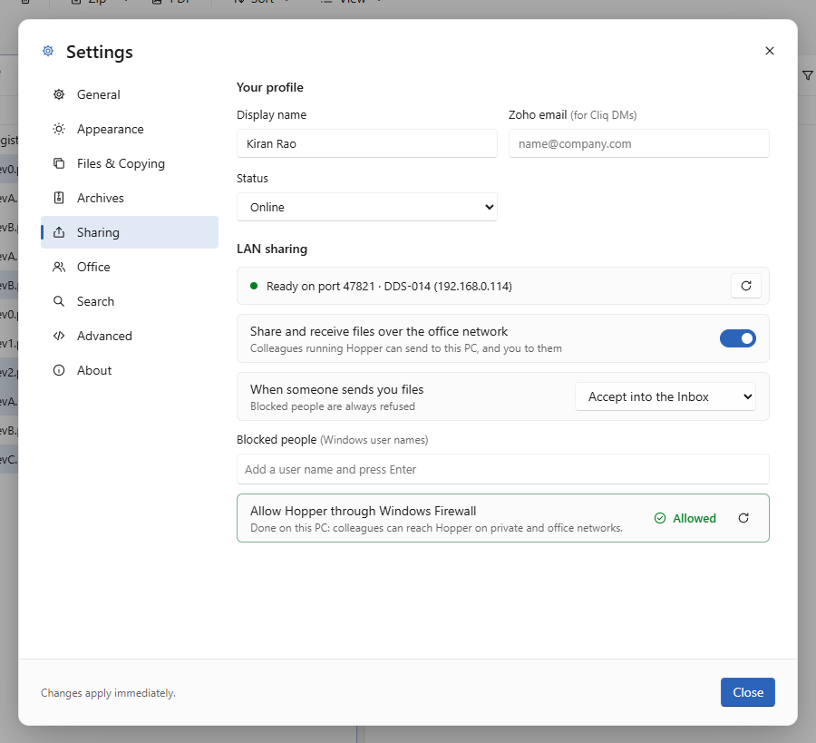

# Setting up Hopper for an office

Hopper works on its own straight after install. Sharing between PCs, groups, templates and the
office rules need a one-time setup, done once, on whichever PC you choose.

## Who does what

- **Before the office is set up**, every PC gets the full *Settings → Office* page, so anyone you
  ask can configure it, and any PC can become the always-on Dexterity Share server.
- **The setup locks to one PC** when that PC presses **Use this PC** in *Set up Dexterity Share*,
  or **Finish setup on this PC** on the Office page. Within about 20 seconds every other PC's
  Office page turns read-only: *"The office is set up by its admin on PC-NAME"*, with the office
  name, where the config was loaded from, whether this PC has **Joined**, the key fingerprint and
  a **Join office** box.
- **Who can still change it** once set up: that PC, and the standing admins (Windows accounts named when Hopper is built) on any PC. Hopper refuses a save from anyone else.
- **Revoke setup** (Office page, for those same people) undoes the lock, for example to move the
  always-on server to another PC. Every PC gets the full page back until the next setup locks it
  again. The old share server keeps serving client links until the new PC presses
  **Use this PC**; then the old one stops by itself.
- **A PC that can't read `office.json`** can't tell whether the office is set up, so it gets the
  read-only page with **Join office**, where the right file can be loaded. Creating the very first
  `office.json` is therefore done by a standing admin, or from a PC that can already read an
  existing one.
- **Announcements**: everyone can post one, from any PC.

The lock stops accidents, not a determined person: anyone who can write the office folder can
edit `office.json` by hand. Keep that folder's permissions tight if that matters.

## 1. Install on every PC

Run `Hopper-<version>-win-x64.exe` on each PC. It installs per user (no admin rights) and updates
itself. Hopper stays in the tray when the window is closed so colleagues can keep sending files;
untick *Settings → General → Keep running in the tray* to change that.

## 2. Create the office config (admin, once)

1. Open **Settings → Office**.
2. **Office config file**: a path every PC can read. The default is
   `\\<file server>\<share>\_Hopper\office.json`. If it doesn't exist yet,
   Hopper creates it when you save. To keep it somewhere else, use **Move office config to…**
   later: it writes `office.json` and the announcements into the folder you pick and leaves a
   pointer in the old file, so PCs that can read the old place follow by themselves. A folder on
   a mapped drive is stored as its `\\server\share` path so it works on every PC.
3. **Office key** → **Generate**. This shared secret encrypts PC-to-PC transfers and lets Hopper
   ignore devices that aren't part of the office. Anyone with the key can send to office PCs.
4. **Server inbox**: where shares for colleagues who are offline wait (default
   `\\<file server>\<share>\_Hopper\Inbox`). Each person gets a sub-folder
   named after their Windows account.
5. **Save to server**.

## 3. Join the other PCs

A PC is **Joined** when it has the office key. It gets it in one of three ways:

1. **From the office config (normal case).** A PC that can read the config file picks the key up
   on start. Nothing to do. If the PC uses a different path, set it under
   *Settings → Office → Join office → Office config file*.
2. **Invite over the LAN.** The admin clicks **Invite PCs** on the Office page. For two minutes,
   every Hopper on the subnet that has **no key** shows a bar: *"Asha (PC-30, 192.168.1.x)
   invites this PC to join Dexterity Design Services — Join / Ignore"*, with the key fingerprint.
   Nothing is applied until the person clicks **Join**. A PC that already has a different key only
   gets a notice. A PC already on the same key ignores the invite.
3. **Paste the key (manual fallback).** The admin copies the key (Office page → copy button) and
   sends it to the team, e.g. in an announcement or a message. Each person pastes it under
   *Settings → Office → Join office → Or paste the office key* and clicks **Join**.

A key that was pasted or accepted from an invite is stored on that PC only and is used when the
office config has no key or can't be reached. When the config has a key, the config wins.

**Fingerprint.** Every Office page shows the first 8 hex characters of the key's SHA-256. Two
people can read their fingerprints to each other to check they are on the same key without
showing the key itself. Check it before joining from an invite.

### What the invite trades away

A PC without the key cannot verify a signature, so the invite is unsigned and **carries the
office key unencrypted on the LAN for those two minutes**. Anyone on the subnet capturing traffic
during that window gets the key, and anyone on the subnet could broadcast a fake invite to a PC
that has no key yet. Hopper limits this: invites are sent only while the admin has the button
running, a PC never joins without a click, the bar shows the sender's PC, address and the key
fingerprint, joined PCs never switch by themselves, and repeated or flooding invites are dropped.
If the office network has devices you don't trust, don't use the invite: let PCs read the config
file, or hand the key over in person. If you think the key leaked, generate a new one and save;
PCs that read the config follow at their next start.

## 4. On each PC

- **Settings → Sharing → Allow through Windows Firewall**. Hopper listens on UDP 47820
  (discovery, invites) and TCP 47821 (transfers, announcements) on private and domain networks.
  Windows asks for admin rights once. The row then reads **Allowed** in green; **Not allowed**
  means the rule is missing (or the administrator prompt was declined) and *Allow* is still
  needed. The status is read from Windows each time the Sharing page opens; the refresh button
  next to *Allowed* checks again.

  

- **Settings → Sharing → Profile**: display name as colleagues should see it, and the Zoho
  email (used for Cliq notices).
- **Settings → General → Inbox folder**: where received files land (default `D:\Hopper Inbox`
  when D: exists, else `Downloads\Hopper Inbox`). Each share gets a folder like
  `2026-11-05 1430 from Arun Kumar`.

## 5. Announcements

Anyone in the office can post an office-wide announcement: **Inbox → Announce**, or *Settings → Office → New announcement*. For example: a
project folder is nearly full, so everyone should make a local backup and clean up.

- **Title, details, level**, an optional **folder** (people get an *Open folder* button) and an
  optional **expiry**.
- **Info**: listed under Announcements, with a toast. **Important**: a banner at the top of
  Hopper until the person clicks **Got it**. **Urgent**: a red banner, a toast that stays, and a
  Windows notification.
- PCs that are on get it at once over the encrypted LAN channel (each PC confirms receipt; Hopper
  retries those that don't). It is also written to `announcements.json` next to `office.json`
  (the newest 200 are kept), so a PC that was off shows it when Hopper next starts.
- **Got it** is recorded on that PC, sent back to the author, and filed in
  `announcement-acks\<user>.json` in the office folder. The author sees who has acknowledged and
  who hasn't under **Announcements**, and can **Withdraw** an announcement.

## 6. People: more than sending files

Clicking a person (sidebar, Home or People) opens their **Person panel**:

- **Message**: a short note, with the notes and shares you have exchanged shown as a conversation.
- **Send files**: what you have *selected*, or files/folders you pick there. A row that merely
  has the focus is never sent.
- **Folder link**: a pointer to a folder or file on a shared drive. Nothing is copied; the other
  person gets **Open folder**, which takes their Hopper there. Mapped drives are sent as
  `\\server\share` paths.
- **Ask for files**: a request the other person answers with **Send files**.

All of these reach an offline colleague through the server inbox when they next open Hopper.

## 7. Optional extras (admin, Settings → Office)

- **Zoho Cliq bot**: one bot DMs each recipient. The endpoint already points at the office's
  Hopper Bot; the admin pastes the bot's webhook token once under *Zoho Cliq bot*, ticks the
  switch and saves. Every PC gets it from the office config. Details: [CLIQ-SETUP.md](CLIQ-SETUP.md).
- **Dexterity Share** (client download links): on one office PC that stays on, **Set up
  Dexterity Share on this PC…** under *Dexterity Share*. Three steps, done in Hopper:
  [DEXTERITY-SHARE-IT.md](DEXTERITY-SHARE-IT.md). How staff use it: [DEXTERITY-SHARE.md](DEXTERITY-SHARE.md).
  In the same place, **Let staff create links from a browser** (on by default) lets staff upload a
  .zip, .rar or .7z on a web page and get a client link without Hopper; **Largest file from a
  browser (GB)** sets the limit (5 GB by default), and **Show browser sign-ins** lists everyone's
  signed-in browsers so you can switch one off.
- **Groups**: e.g. *Piping team* → `arun, priya, ravi` (Windows account names). Type `@Piping`
  in the Share dialog to send to all of them.
- **Folder templates**: one folder per line, with `{name}`, `{project}` and `{date}` tokens,
  e.g. `{name}/01_Received`.
- **Naming conventions**: a regular expression the file name (without extension) must match in
  full, e.g. `ISO-\d{4}_Rev[0-9A-Z]{1,2}`. The lot packager checks every file against the chosen
  convention before it writes anything.
- **Revision rules**: patterns that find the revision in a name (named group `rev`), and an
  optional order such as `A, B, C, 0, 1, 2`. With no order, numbers compare with numbers and
  letters with letters; a mix is reported as *order unknown* and left for a person to check.
  Hopper never guesses which revision is latest.

## How sharing behaves

- **Online colleague**: files go straight to their PC over TLS, in up to four parallel streams,
  each file checksum-verified. A dropped connection resumes where it stopped.
- **Offline colleague**: files are copied to their server inbox; when their Hopper starts it
  moves them to their local Inbox and they get a notification (and a Cliq DM if enabled).
- **Receiving**: shares are accepted automatically into the Inbox. *Settings → Sharing* can ask
  first, or block specific people. Messages, links and requests are never held for approval
  (they carry no files), but a blocked person's are refused.

## Troubleshooting

| Symptom | Check |
| :-- | :-- |
| Office page says *Not joined* | The PC can't read the office config and has no pasted key. Fix the config path, paste the key, or ask the admin to invite. |
| People list is empty | Both PCs *Joined* with the **same fingerprint**; Settings → Sharing shows the firewall as **Allowed** on both; both PCs on the same subnet. The rule covers private and domain networks only, so a PC whose network is set to *Public* in Windows is still blocked. |
| No Join bar after the admin invites | The PC already has a key (it gets a notice instead), the firewall blocks UDP 47820, or the PC clocks differ by more than 10 minutes. |
| "port-in-use" | Another Hopper (or app) uses TCP 47821; Hopper tries up to 47830 automatically. |
| Shares always go via the server | The firewall is blocking TCP 47821 on the receiving PC. |
| An announcement did not reach a PC that was off | That PC can't read the office folder. It still gets announcements while it is on. |
| "The office is set up on PC-NAME; only that PC, or a standing admin, can change it" | Make the change on that PC, ask a standing admin, or have one of them **Revoke setup** first. |
| No Cliq DM | Bot enabled, endpoint and zapikey saved; the recipient's Zoho email is filled in and they have subscribed to the bot. Use *Send test DM*. |
